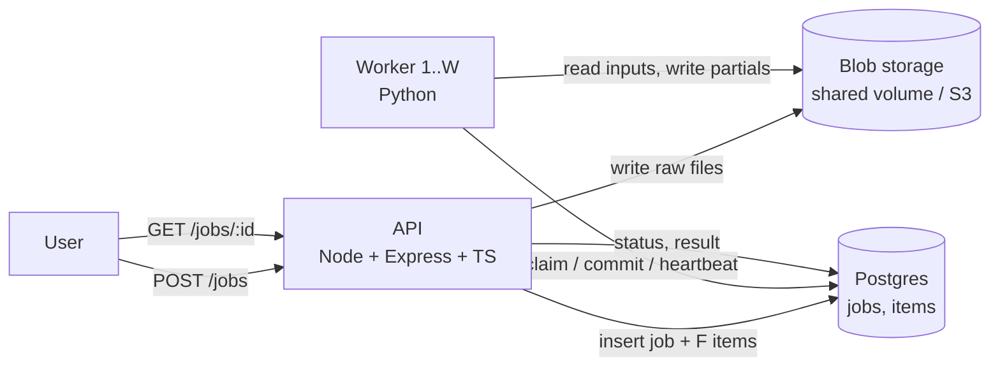
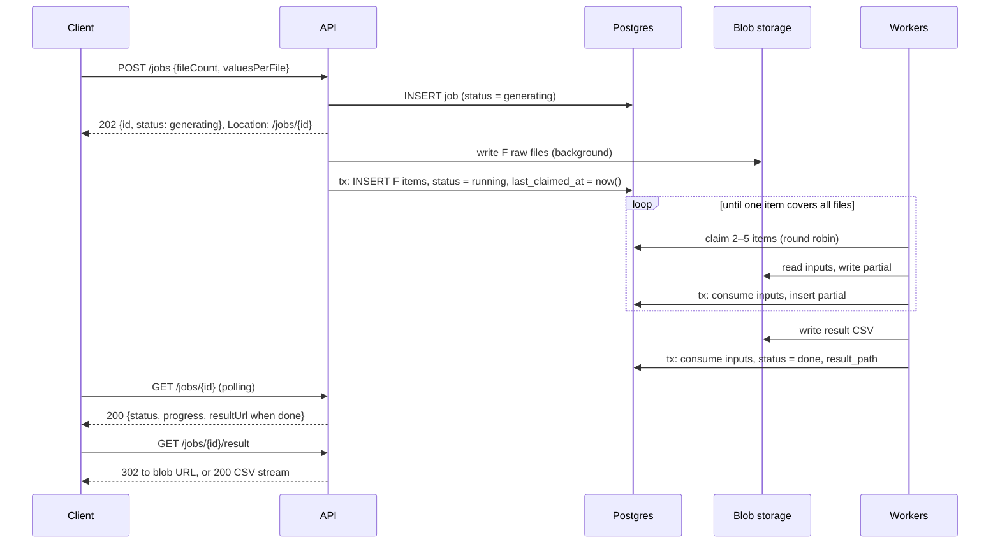

# Distributed Mean — Design

## 1. Overview

A user submits a job with a number of files and a number of values per file. The system computes the mean of every index across all files and returns a single file of means, one per index.

Work is done by a fixed fleet of W Python workers. A worker may read at most 5 inputs per task, so jobs are reduced as a tree of merges. Postgres is both the queue and the source of truth; files live in blob storage behind an interface.

The problem is modelled on the server-side aggregation step of federated learning: each file is one client's update, the mean is FedAvg with equal weights, and the 5-file limit is the aggregator's memory limit, which forces aggregation to be spread across a fleet of workers. Synchronous federated learning waits for every update in a round before aggregating; asynchronous federated learning aggregates whatever has arrived. We borrow the asynchronous idea and apply it to partials: merge whatever is ready instead of waiting for a whole level. Unlike federated learning, there is a single round and no model versions, so there is no staleness weighting and the result must be exact.

**Notation:** F = `file_count`, C = `values_per_file`, W = number of workers.

## 2. Requirements

- Create a job via an API call with F and C. (1 < F < 100k, 1 < C < 1M)
- W workers sit idle until work appears, and start as soon as a job is enqueued.
- A worker processes at most 5 files per task.
- Workers run at different speeds; minimise idle time and waiting on slow workers.
- Multiple jobs can be submitted and processed concurrently.
- The system detects when a job is finished and produces the final file.

## 3. Assumptions

- **5-file limit is per task.** A task takes at most 5 inputs (raw files or partials). Reading it as "5 files in memory at once" would allow one task to stream every file sequentially, which defeats the problem's requirement to split jobs when F > 5.
- **Partials count as inputs.** A partial is a length-C vector, the same size in memory as a file.
- **Generation is out of scope.** Input data is assumed to already exist at rest, as in the inspiration. The API generates files with the simplest approach; generation time isn't optimised.
- **Values are integers 0–999, stored as int32** (ITD 8). The problem lets us choose bounds. The API rejects jobs where 999 × F ≥ 2^31, so sums can never overflow.
- **Design for max sizes, run at moderate ones.** F = 100k × C = 1M is ~10^11 values (~400 GB of inputs). Local runs use sizes like F = 1k, C = 10k.
- **Worker speed is unknown to the system.** Simulated as a per-worker factor × random jitter × cost proportional to files × C. The design must not depend on knowing which workers are slow.
- **One task per worker at a time.**
- **One API instance.** Resuming generation after a crash is safe with several instances, but would duplicate work without a claim on the job.

## 4. Architecture



- **API**: validates input, generates raw files, creates the job and its F items, exposes job status and results.
- **Postgres**: `jobs` and `items` tables. Items are the queue (ITD 2).
- **Blob storage**: `BlobStore` interface; shared Docker volume now, S3 later (ITD 7).
- **Workers**: stateless loop of claim → merge → commit. No coordinator.

## 5. Data model

```sql
jobs (
  id               uuid primary key,
  file_count       int not null,         -- F
  values_per_file  int not null,         -- C
  status           text not null,        -- generating | running | done | failed
  result_path      text,
  created_at       timestamptz not null,
  last_claimed_at  timestamptz not null, -- round-robin position; set when the job becomes running
  completed_at     timestamptz
)

items (
  id               uuid primary key,
  job_id           uuid not null references jobs(id),
  path             text not null,        -- blob path of an int32 vector of length values_per_file
  files_covered    int not null,         -- original files summed into this vector; 1 = raw file
  claimed_by       text,                 -- worker id
  lease_expires_at timestamptz,
  created_at       timestamptz not null
)

create index jobs_rr_idx on jobs (last_claimed_at, created_at) where status = 'running';
create index items_job_idx on items (job_id, files_covered desc);
```

Raw files and partials share one format, so there is no `kind` column: `files_covered = 1` identifies a raw file (a partial always covers ≥2).

**Invariant:** for a running job, `files_covered` summed over its items plus over its in-flight tasks equals `file_count`. A job therefore always has ≥2 claimable items or at least one task in flight.

## 6. Algorithm

### 6.1 Job lifecycle

1. API receives `{fileCount, valuesPerFile}`, inserts the job with status `generating`, and returns immediately.
2. In the background, the API generates the F raw files (§6.4), then in one transaction flips the job to `running` with `last_claimed_at = now()` and inserts F items (`files_covered = 1`).
3. Workers claim 2–5 items of a job (§6.2), sum them, write one partial file.
4. The worker commits (§6.3): consume inputs, insert the partial with `files_covered` = sum of the inputs' `files_covered`.
5. When a merge produces `files_covered = file_count`, the commit records the result path, marks the job `done`, and inserts no item.

Why it's correct: merging (sum, files covered) is associative and commutative, so any grouping produces the same total (ITD 1). Integer sums make it exact.

### 6.2 Claim (one short transaction)

```sql
BEGIN;
SELECT j.id FROM jobs j
WHERE j.status = 'running'
  AND (SELECT count(*) FROM (
         SELECT 1 FROM items i
         WHERE i.job_id = j.id AND (i.claimed_by IS NULL OR i.lease_expires_at < now())
         LIMIT 2) t) = 2
ORDER BY j.last_claimed_at, j.created_at
LIMIT 1
FOR UPDATE SKIP LOCKED;

UPDATE items SET claimed_by = :worker, lease_expires_at = now() + interval '30 seconds'
WHERE id IN (
  SELECT id FROM items
  WHERE job_id = :job AND (claimed_by IS NULL OR lease_expires_at < now())
  ORDER BY files_covered DESC
  LIMIT 5 FOR UPDATE SKIP LOCKED
)
RETURNING id, path, files_covered;

UPDATE jobs SET last_claimed_at = now() WHERE id = :job;
COMMIT;
```

- Round robin across jobs by `last_claimed_at`, updated at claim time (ITD 5).
- Largest partials first keeps partials on disk around W (ITD 4).
- `jobs_rr_idx` matches both the `WHERE status = 'running'` predicate and the `ORDER BY`, so Postgres walks running jobs in round-robin order and stops at the first eligible one. Walks at most W jobs and ~6W item rows. To verify with `EXPLAIN` once implemented.
- No eligible job → sleep briefly and retry (polling; `LISTEN/NOTIFY` later).

### 6.3 Merge, heartbeat, commit

1. Read inputs from blob storage, sum in int64 in memory, assert the result fits int32, write it as int32 to `partials/{job_id}/{uuid}.bin` (unique per attempt). For the final merge, write `results/{job_id}.csv` with `sum / file_count`.
2. While merging, renew the lease every 10 s, only on items this worker still holds:

```sql
UPDATE items SET lease_expires_at = now() + interval '30 seconds'
WHERE id = ANY(:inputs) AND claimed_by = :worker;
```

If fewer rows are renewed than claimed, another worker re-claimed some inputs after this worker's lease expired. The worker logs it and keeps going; whichever commits first wins.

3. Commit in one transaction:

```sql
BEGIN;
DELETE FROM items WHERE id = ANY(:inputs);
-- if rows deleted != len(inputs): ROLLBACK, discard work
INSERT INTO items (job_id, path, files_covered) VALUES (:job, :path, :files_covered);
-- or, if :files_covered = file_count:
--   UPDATE jobs SET status = 'done', result_path = :path, completed_at = now() WHERE id = :job;
COMMIT;
```

4. After a successful commit, delete consumed partial files (`files_covered > 1`) from storage. Raw files are kept.

### 6.4 Generation and resume

Generation is one function, `generateJob(job)`, used both by `POST /jobs` and by startup recovery:

1. For each file index `i` in `0..F-1`: if `raw/{job_id}/{i}.bin` already exists, skip it. Otherwise generate values with a PRNG seeded by `(job_id, i)`, write to a temp path, fsync, and rename into place.
2. Flip and enqueue in one transaction:

```sql
BEGIN;
UPDATE jobs SET status = 'running', last_claimed_at = now()
WHERE id = :job AND status = 'generating';
-- if 0 rows updated: someone else already flipped it, ROLLBACK
INSERT INTO items (job_id, path, files_covered) SELECT :job, ..., 1 ...;  -- F rows
COMMIT;
```

On startup, before serving traffic, the API runs `generateJob` for every job with `status = 'generating'`. Those are jobs whose in-process generation died with the previous process; nothing else would ever move them forward.

Why resuming is safe:

- **Deterministic content:** the same seed produces the same file, so rewriting a file is harmless.
- **Atomic file writes:** temp + fsync + rename means a file under its final name is always complete, so existence alone is enough to skip it. The fsync matters only for machine crashes: without it, some filesystems can persist the rename before the data and leave an empty file.
- **Workers never see a half-generated job:** items only exist after the flip transaction, which runs once all files exist.
- **The flip happens at most once:** the conditional `UPDATE ... WHERE status = 'generating'` lets only one caller insert items, so even two API instances can't enqueue a job twice; they would only duplicate generation work.

Generations run through a small in-process concurrency limit so a burst of jobs doesn't saturate the disk.

## 7. Multi-job scheduling

Covered by the claim query: each claim serves the job that was served longest ago and has work available. A job joins the back of the current cycle when it becomes `running`. Concurrent claims skip jobs locked by other claimers. No semaphore or scheduler process exists (ITD 5).

Tradeoff: fairness is by claims, not by work; jobs with more values per file consume more worker time per cycle.

## 8. Failure handling and correctness

| Failure                                                 | Handling                                                                                    |
| ------------------------------------------------------- | ------------------------------------------------------------------------------------------- |
| Worker crashes mid-task                                 | Lease expires in ≤30 s; items become claimable again                                        |
| Worker slow but alive                                   | Heartbeat renews lease; keeps its items                                                     |
| Worker paused past lease, others take overlapping items | Heartbeat only renews items it still holds; first commit wins, loser rolls back (ITD 3)     |
| Crash after writing partial, before commit              | Orphan file; no row references it; GC later                                                 |
| Crash during commit                                     | Transaction is atomic; either fully applied or not at all                                   |
| Duplicate completion                                    | Impossible: final merge consumes its inputs in the same transaction that marks the job done |
| API crashes during generation                           | Job stays `generating` with no items; on startup the API resumes generation (§6.4)          |

Double counting is prevented solely by the commit consuming all inputs or none. Leases affect efficiency and progress, not correctness.

## 9. Performance and scale

- **Tasks per job:** ≈ (F−1)/4 with fan-in 5.
- **Finish time:** ≈ total work ÷ total worker speed, plus a short tail where the tree narrows below W tasks. Unaffected by claim order (simulated).
- **Intermediate storage:** ~W partials (≤ ~5W counting in-flight), independent of F.
- **Reads at max size:** every item is read exactly once. Raw: 100k files × 1M values × 4 B = 400 GB. Partials: ~25k tasks each produce one 4 MB partial = ~100 GB. Summing 20 MB of inputs per task takes milliseconds of CPU, while reading it from shared storage takes tens of milliseconds or more, so storage bandwidth is the bottleneck at scale, not compute (estimate).
- **Claim cost:** O(W) rows, independent of the number of jobs or items.
- **Scaling path:** S3 instead of a shared volume; `LISTEN/NOTIFY` instead of polling; split tasks along C (column ranges) to bound per-task cost across jobs with very different C; shard by job if Postgres claim throughput becomes the limit.

## 10. Observability

- Workers log every claim, heartbeat shortfall, commit, and rollback with worker id, job id, input item ids, files covered, and duration.
- API logs job creation (file count, values per file, job id), generation start/end, and completion.
- Progress = (F − items remaining) / (F − 1): every merge of k items removes k−1, and a job needs F−1 removals in total. Items remaining is `SELECT count(*) FROM items WHERE job_id = :id`, served by `items_job_idx`. In-flight inputs still count as remaining until their merge commits. If status polling becomes frequent at large F, keep an `items_remaining` column on `jobs` updated in the commit transaction.

## 11. API

| Method | Path               | Purpose                 |
| ------ | ------------------ | ----------------------- |
| POST   | `/jobs`            | Create a job            |
| GET    | `/jobs/:id`        | Job status and progress |
| GET    | `/jobs/:id/result` | Download the result CSV |

**`POST /jobs`**

```json
// request
{ "fileCount": 1000, "valuesPerFile": 10000 }

// 202 Accepted
{ "id": "6f1c…", "status": "generating", "fileCount": 1000, "valuesPerFile": 10000, "createdAt": "2026-10-11T12:00:00Z" }
```

- `fileCount`: integer, 2–99,999. `valuesPerFile`: integer, 2–999,999. Otherwise `400 { "error": "…" }`.
- `202` because the work is accepted but not done; the body carries the job `id`, and the `Location: /jobs/{id}` header points at the status endpoint to poll.
- Returns before files are generated; generation runs in the background (§6.1).

**`GET /jobs/:id`**

```json
// 200 OK
{
  "id": "6f1c…",
  "status": "running",
  "fileCount": 1000,
  "valuesPerFile": 10000,
  "progress": 0.42,
  "createdAt": "2026-10-11T12:00:00Z",
  "completedAt": null
}
```

- When `done`, also includes `"resultUrl": "/jobs/6f1c…/result"`.
- `404` if the job doesn't exist.

**`GET /jobs/:id/result`**

- `302` redirect to a direct blob URL when the storage backend supports one (S3 presigned URL, short expiry), so the download bypasses the API.
- `200` with `text/csv`, streamed by the API, when it doesn't (local shared volume).
- The choice lives behind `BlobStore.getDownloadUrl(path)`, which returns a URL or nothing. Clients that follow redirects work the same with either backend.
- CSV content: one line per index, the mean across all files.
- `409` if the job isn't `done`; `404` if it doesn't exist.

### Request flow and status transitions



| Status       | Set by | When                                                         |
| ------------ | ------ | ------------------------------------------------------------ |
| `generating` | API    | `POST /jobs` inserts the job                                 |
| `running`    | API    | Same transaction that inserts the F items, after files exist |
| `done`       | Worker | Same transaction as the final merge's commit                 |
| `failed`     | API    | Generation hits an unrecoverable error (e.g. disk full)      |

## 12. Future work

- Backup copies of slow tasks (already safe under ITD 3).
- Orphan file garbage collection.
- Round robin over the K oldest jobs; work-weighted fairness.
- `GET /jobs` listing; configurable W via the API; UI with live system state (bonus).

## 13. Decisions

| ITD                                                | Decision                                                      |
| -------------------------------------------------- | ------------------------------------------------------------- |
| [1](decisions/ITD-001-aggregation-model.md)        | (sum, files covered) partials merged in a runtime-shaped tree |
| [2](decisions/ITD-002-postgres-queue.md)           | Postgres as queue and source of truth                         |
| [3](decisions/ITD-003-exactly-once-consumption.md) | Atomic consume-on-commit, first commit wins                   |
| [4](decisions/ITD-004-merge-policy.md)             | Claim 2–5 items, largest partials first                       |
| [5](decisions/ITD-005-multi-job-scheduling.md)     | Round robin across jobs by last claim time                    |
| [6](decisions/ITD-006-slow-and-failed-workers.md)  | Pull-based claiming, 30 s heartbeated leases                  |
| [7](decisions/ITD-007-blob-storage.md)             | Blob storage interface on a shared volume                     |
| [8](decisions/ITD-008-file-format.md)              | Integers in raw little-endian int32 binary                    |
